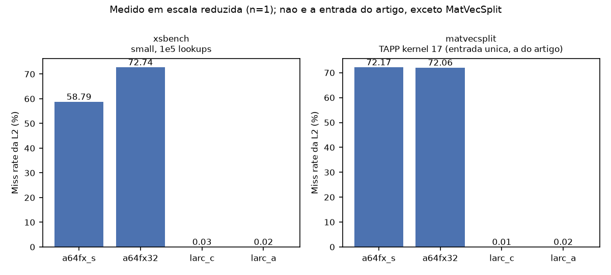
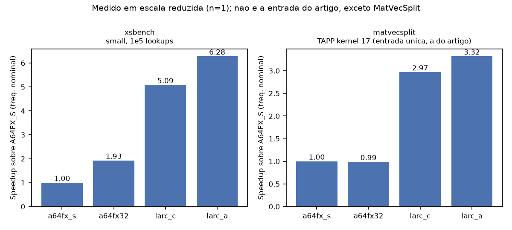

# Resultados preliminares — workloads complexos e integração com o McPAT (Membro 3)

Situação em 2026-10-12, 17:35. Tabelas completas e CSV em [`../results/entrega/`](../results/entrega/);
histórico de problemas em [`RELATORIO_TECNICO.md`](RELATORIO_TECNICO.md).

**Como ler este documento.** Há dois tipos de número, nunca misturados na mesma tabela:

- **Medido**: saída do Sniper 8.1 e do McPAT 1.0 em execuções reais, com entrada reduzida
  (uma repetição). Só o MatVecSplit usa a entrada do artigo.
- **Projetado**: valor medido × fator de escala até a entrada do artigo. É uma conta, não uma
  simulação, e vem sempre rotulado como projeção.

---

## 1. Compilação

Compilação completa refeita do zero dentro do contêiner, sem erros
(`results/_logs/build_20261012_154236.log`).

| Workload | Fonte | Binário | Flags | Verificação nativa |
|---|---|---|---|---|
| NPB MG-OMP | NPB 3.4.4, `NPB3.4-OMP/MG` | `mg.S.x`, `mg.W.x`, `mg.B.x` | `gfortran -O3 -mavx2 -mfma -fopenmp` | `VERIFICATION SUCCESSFUL` |
| XSBench | v20 (`ba08e52`), `openmp-threading` | `XSBench` | `gcc -std=gnu99 -flto -O3 -mavx2 -mfma -fopenmp -DOPENMP -DSNIPER_ROI` | checksum 941535 `(Valid)` na entrada padrão |
| MatVecSplit | TAPP kernels (`112d97e`), `Adventure.region0` | `matvecsplit` | `gcc -std=gnu99 -O3 -mavx2 -mfma -fopenmp` | `OK` (resultado = referência 4,268738964 × 10¹⁰) |

Compilador: GCC / gfortran 13.3.0 (Ubuntu 24.04, imagem `larc-thermal-sniper:latest`).
AVX2 no lugar de AVX-512 porque a CPU hospedeira não tem AVX-512.

---

## 2. Execução no Sniper — valores medidos

Cada execução passa por quatro verificações: código de saída, ROI aberta e fechada, verificação
numérica do próprio benchmark e resultado idêntico ao da execução nativa.

| Workload | Entrada | Cenário | Núcleos / L2 | Instruções na ROI | Tempo simulado | IPC | Miss L2 | Igual ao nativo |
|---|---|---|---|---|---|---|---|---|
| MG | classe S (32³) | A64FX_S | 12 / 8 MiB | 3,33 × 10⁷ | 0,52 ms | 2,40 | 0,38% | sim |
| MG | classe S (32³) | LARC_A | 32 / 512 MiB | 2,04 × 10⁸ | 1,04 ms | 2,79 | 0,24% | sim |
| XSBench | small, 10⁵ lookups | A64FX_S | 12 / 8 MiB | 1,13 × 10⁸ | 9,90 ms | 0,43 | **58,79%** | sim |
| XSBench | small, 10⁵ lookups | A64FX32 | 32 / 8 MiB | 1,20 × 10⁸ | 5,13 ms | 0,33 | **72,74%** | sim |
| XSBench | small, 10⁵ lookups | LARC_C | 32 / 256 MiB | 1,17 × 10⁸ | 1,95 ms | 0,86 | 0,03% | sim |
| XSBench | small, 10⁵ lookups | LARC_A | 32 / 512 MiB | 1,16 × 10⁸ | 1,58 ms | 1,05 | 0,02% | sim |
| MatVecSplit | **entrada do artigo** | A64FX_S | 12 / 8 MiB | 5,16 × 10⁷ | 4,24 ms | 0,46 | **72,17%** | sim |
| MatVecSplit | **entrada do artigo** | A64FX32 | 32 / 8 MiB | 1,51 × 10⁸ | 4,29 ms | 0,50 | **72,06%** | sim |
| MatVecSplit | **entrada do artigo** | LARC_C | 32 / 256 MiB | 1,24 × 10⁸ | 1,43 ms | 1,23 | **0,01%** | sim |
| MatVecSplit | **entrada do artigo** | LARC_A | 32 / 512 MiB | 1,18 × 10⁸ | 1,28 ms | 1,32 | **0,02%** | sim |

O que esses números sustentam:

- **O fluxo funciona nos quatro cenários**, de 12 e de 32 núcleos, com L2 de 8 a 512 MiB.
  XSBench e MatVecSplit estão medidos nos quatro; o MG, em dois.
- **MatVecSplit (escala real, quatro cenários) — o resultado principal desta entrega:**

  | Cenário | Miss L2 | Tempo simulado | Speedup sobre A64FX_S (frequência nominal) |
  |---|---|---|---|
  | A64FX_S | 72,17% | 4,24 ms | 1,00× |
  | A64FX32 | 72,06% | 4,29 ms | 0,99× |
  | LARC_C | 0,01% | 1,43 ms | 2,97× |
  | LARC_A | 0,02% | 1,28 ms | 3,32× |

  Mais núcleos com a mesma cache não ajudam (0,99×): o kernel divide o trabalho em 12 fatias
  fixas e os 20 núcleos extras só fazem espera ativa. Todo o ganho vem da capacidade da L2: os
  ~101 MB da matriz passam a caber, o miss rate cai de 72% para ~0% e o IPC sobe de 0,46 para
  1,23. O LARC_A ganha mais 12% sobre o LARC_C. É o speedup **teórico** (2,2 GHz fixos), isto
  é, o valor que o modelo térmico do Membro 1 vai corrigir para baixo. O artigo-base reporta
  46,7% de miss no A64FX_S para este kernel. Uma repetição por cenário.

  
  
- **XSBench (tabela de 241 MB, 10⁵ lookups, quatro cenários):**

  | Cenário | Miss L2 | Tempo simulado | Speedup sobre A64FX_S (frequência nominal) |
  |---|---|---|---|
  | A64FX_S | 58,79% | 9,90 ms | 1,00× |
  | A64FX32 | 72,74% | 5,13 ms | 1,93× |
  | LARC_C | 0,03% | 1,95 ms | 5,09× |
  | LARC_A | 0,02% | 1,58 ms | 6,28× |

  Aqui os dois efeitos aparecem separados. Mais núcleos com a mesma cache de 8 MiB dão 1,93×
  (e o miss rate piora, de 59% para 73%, pela disputa da cache). Trocar a cache por 256 MiB dá
  mais 2,6× em cima disso, com o miss rate indo a zero. De 256 para 512 MiB o miss rate não
  muda (já está em zero); os 23% a mais do LARC_A devem vir da banda maior entre L1 e L2
  (única outra diferença entre os dois cenários), o que não foi isolado em teste próprio. É a
  saturação da L2 em 256 MiB que o artigo-base descreve (32,1% → 0,1%). A entrada tem 10⁵
  lookups em vez de 1,5 × 10⁷; a tabela de dados é a mesma. Uma repetição por cenário.
- **MG classe S não mede efeito de cache:** a grade de 32³ cabe em qualquer L2.

O que **falta** (ver seção 5): MG classe W nos quatro cenários, que é a entrada reduzida capaz
de mostrar efeito de cache no MG.

---

## 3. Integração com o McPAT — valores medidos

O McPAT rodou ao final de todas as execuções acima (6 a 15 s cada). Potência bruta do modelo
(x86 genérico, 22 nm, 330 K), **antes** da normalização para o orçamento do artigo-base.

| Workload / cenário | Lógica estática | Lógica dinâmica | L2 estática | L2 dinâmica |
|---|---|---|---|---|
| MG (S) / A64FX_S | 4,46 W | 65,38 W | 0,99 W | 1,12 W |
| MG (S) / LARC_A | 12,24 W | 143,22 W | 20,87 W | 4,14 W |
| XSBench / A64FX_S | 4,46 W | 15,90 W | 0,99 W | 0,84 W |
| XSBench / A64FX32 | 11,95 W | 35,56 W | 0,99 W | 3,82 W |
| XSBench / LARC_C | 12,20 W | 74,30 W | 10,80 W | 38,01 W |
| XSBench / LARC_A | 12,24 W | 89,33 W | 20,87 W | 62,03 W |
| MatVecSplit / A64FX_S | 4,46 W | 30,85 W | 0,99 W | 0,23 W |
| MatVecSplit / A64FX32 | 11,95 W | 50,28 W | 0,99 W | 0,23 W |
| MatVecSplit / LARC_C | 12,20 W | 121,96 W | 10,80 W | 8,75 W |
| MatVecSplit / LARC_A | 12,24 W | 132,65 W | 20,87 W | 12,90 W |

Tendências que o modelo mostra:

- **L2 estática cresce com a capacidade:** 0,99 W (8 MiB) → 10,80 W (256 MiB) → 20,87 W (512 MiB).
- **Lógica estática cresce com o número de núcleos:** 4,46 W (12) → ~12 W (32).
- **Lógica dinâmica acompanha a atividade:** no MatVecSplit ela sobe de 50 W (A64FX32, IPC 0,50)
  para 122 W (LARC_C, IPC 1,23) com os mesmos 32 núcleos. A cache grande tira os núcleos da
  espera por memória e eles passam a dissipar mais. Esse é o mecanismo que a pergunta do
  trabalho investiga: o ganho de desempenho vem junto com mais calor.

Os watts absolutos não são os do LARC (que é ARM a 1,5 nm). O que segue para o modelo térmico é
a proporção entre componentes e entre cenários.

---

## 4. Projeção para a entrada do artigo

**Não é resultado de simulação.** Regra: instruções e tempo simulado × fator de trabalho
(MG: pontos da grade × iterações; XSBench: número de lookups); IPC e potência mantidos.

| Workload | Cenário | Base medida | Fator | Instruções projetadas | Tempo simulado projetado | Miss L2 | Tempo de simulação estimado |
|---|---|---|---|---|---|---|---|
| MG classe B | A64FX_S | classe S | 2.560 | 8,5 × 10¹⁰ | 1,34 s | não projetado (artigo-base: 59,8%) | ~47 h |
| MG classe B | LARC_A | classe S | 2.560 | 5,2 × 10¹¹ | 2,65 s | não projetado (artigo-base: 0,4%) | ~270 h |
| XSBench 1,5 × 10⁷ | A64FX_S | 10⁵ lookups | 150 | 1,70 × 10¹⁰ | 1,48 s (1,00×) | 58,79% | ~11 h |
| XSBench 1,5 × 10⁷ | A64FX32 | 10⁵ lookups | 150 | 1,81 × 10¹⁰ | 0,77 s (1,93×) | 72,74% | ~16 h |
| XSBench 1,5 × 10⁷ | LARC_C | 10⁵ lookups | 150 | 1,76 × 10¹⁰ | 0,29 s (5,09×) | 0,03% | ~9 h |
| XSBench 1,5 × 10⁷ | LARC_A | 10⁵ lookups | 150 | 1,74 × 10¹⁰ | 0,24 s (6,28×) | 0,02% | ~11 h |
| MatVecSplit | os quatro | já medido na escala do artigo (seção 2) | 1 | — | — | — | 4 a 7 min |

Confiança de cada projeção:

- **XSBench — razoável.** O custo por lookup é constante (~1.170 instruções) e a tabela é a
  mesma em qualquer tamanho. Falta o segundo ponto (10⁶ lookups) para medir o erro da regra.
- **MG — baixa.** A base é a classe S, que cabe na cache; a classe B não cabe em 8 MiB, então
  o IPC real no A64FX_S será bem menor e o tempo, maior que o projetado. Em 32 núcleos a classe S
  é dominada por espera ativa (6× mais instruções que em 12 núcleos para o mesmo problema), o
  que infla a projeção do LARC_A. Por isso o miss rate do MG não é projetado, e o speedup
  projetado do MG (0,51×) **não deve ser usado**: ele reflete esse artefato, não a arquitetura.
  A classe W (128³, ~58 MiB) corrige isso e é a próxima execução.

---

## 5. O que não foi concluído e por quê

| Execução | Situação |
|---|---|
| MG classe W nos quatro cenários | interrompidas aos ~44 min de um limite de 2 h; não repetidas por prazo |
| MG classe S em A64FX32 e LARC_C | não executadas por prazo |
| XSBench 10⁶ nos quatro cenários | não executadas por prazo |

Duas causas, ambas do ambiente e não dos workloads:

1. **O Sniper 8.1 fixa todas as threads de simulação na CPU 0 do hospedeiro**
   (`trace_thread.cc`, `pinTraceThreadToCPU`). Sete simulações em paralelo dividiram um único
   núcleo por cerca de 30 minutos, até o problema ser identificado e contornado.
2. **O sistema encerrou os processos por falta de memória** (notebook de 13 GiB com sete
   simulações mais navegador). As simulações em andamento foram perdidas.

Para retomar: no máximo duas ou três simulações por vez, cada uma em CPUs próprias
(`M3_CPUSET=...` em `scripts/common.sh`), com o navegador fechado.

---

## 6. Limitações

x86 com AVX2 em vez de ARM com SVE; simulação por intervalos em vez de ciclo a ciclo; McPAT 1.0 a
22 nm; TLB não modelada; MatVecSplit limitado a 12 threads; uma repetição por ponto (o artigo
pede mediana de três); frequência fixa em 2,2 GHz no Sniper, com o modelo térmico aplicado depois.
